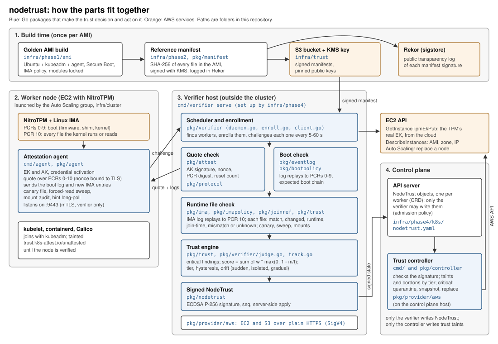

# nodetrust

Continuous trust scoring and out-of-band containment for Kubernetes worker
nodes, using AWS NitroTPM attestation and Linux IMA.

M.Tech project, Cybersecurity Systems and Networks, Amrita Vishwa
Vidyapeetham. Design document: Blueprint v2.

## What the project does

Every worker node in the cluster is checked from outside the cluster, about
once a minute, for as long as it runs:

1. A verifier on its own EC2 instance asks the node's attestation agent for a
   TPM quote. The quote is signed inside the NitroTPM, so the node's own
   software cannot fake it.
2. The verifier checks the boot chain (PCRs 0-9 and the boot event log) and
   every file the kernel ran or read since boot (PCR 10 and the IMA log)
   against a signed reference manifest of the AMI the node was built from.
3. Anything that is not in the manifest or the runtime policy counts
   against the node. A replaced kubelet, a kernel module or a changed boot
   file is critical. Smaller changes lower a score from 100, and the score
   gives a tier: healthy, warning, degraded or untrusted.
4. The verifier publishes each node's state to the cluster as a signed
   NodeTrust object. Only the verifier can write it, and anyone can check
   its signature, so a compromised node or cluster admin cannot fake a
   healthy state.
5. A trust controller checks the signed states and acts on them: taints
   and cordons for the score tiers, and for a critical node an out-of-band
   quarantine through the AWS API (empty security group, network ACL deny,
   evidence snapshots, replacement from the Auto Scaling group), with a
   dry-run mode, a verifier-outage guard and a circuit breaker.

## Why it is useful

Kubernetes trusts a node once it has joined. If the node is later
compromised (a changed binary, a rootkit module, an edited kubelet config),
nothing in Kubernetes notices, and the node keeps running workloads and
holding secrets. Tools that run on the node itself, such as Falco, can be
switched off by the same attacker.

This project gives a check that the node cannot switch off: the evidence is
signed by the TPM, checked on another machine, and compared with a manifest
that was signed when the AMI was built and logged in a public transparency
log (Rekor). The result is not just pass or fail but a score, so small
config drift and a real compromise are told apart.

## Architecture



How a node is checked, module by module (input -> output):

| Module | Input | Output |
| --- | --- | --- |
| `cmd/agent`, `pkg/agent` | verifier challenge over mTLS | TPM quote of PCRs 0-10, boot event log, new IMA log entries, canary, sweep and mount reports |
| `pkg/protocol` | - | the agent <-> verifier messages (JSON) |
| `pkg/verifier` | list of workers from EC2 | a challenge to each node every 5-60 s; the node's tracked state |
| `pkg/provider/aws` | instance ID | the TPM's real EK (`GetInstanceTpmEkPub`), AMI, zone and IP |
| `pkg/attest` | quote, AK, nonce | signature and PCR digest checked; TPM reset count |
| `pkg/eventlog`, `pkg/bootpolicy` | boot event log, quoted PCRs 0-9 | log replays to the quote; boot chain is the expected one |
| `pkg/manifest` | signed manifest from S3, pinned keys | verified list of file hashes for the AMI |
| `pkg/ima` | IMA binary log, quoted PCR 10 | list of measured files (path, SHA-256) that replays to the quote |
| `pkg/imapolicy` | measured files, manifest, runtime policy | each file: match, changed, runtime, join, mismatch or unknown |
| `pkg/joinref` | node ID, zone, IP | expected hashes of the files kubeadm writes at join |
| `pkg/trust` | classified files, mount report | critical findings, score, tier, drift class |
| `pkg/nodetrust` | node state | signed NodeTrust object in the API server |
| `pkg/controller` | signed NodeTrust objects, Nodes | taints, cordon, evictions; the critical path |
| `pkg/provider/aws` (containment) | instance ID | quarantine group and ACL deny, snapshots, detach from the group, terminate |
| `cmd/controller` | config.json | the controller service, `approve` and `terminate` |
| `pkg/metrics` | counters, histograms, current state | Prometheus text format on /metrics |
| `cmd/verifier` | config.json | the verifier service and its command-line tools |

The full picture of each phase, with the reasons for each design choice and
every live result, is in the phase READMEs under `infra/`.

## Getting started

### Requirements

For the quick start (no AWS needed):

- Go 1.24 or later
- make
- a C compiler, only for `make test-sim` (the TPM simulator is C code built through cgo)

For the full run on AWS, also:

- an AWS account and the AWS CLI v2, logged in, with a region set
  (`aws configure` or `AWS_REGION`). The live runs used ap-south-1.
- Terraform 1.6 or later
- Python 3 (standard library only), curl, openssl, tar, gzip

The Go code uses only the standard library and go-tpm (agent side). The
AWS and Kubernetes clients are written with the standard library.

### Quick start

```
git clone https://github.com/shashi2504/nodetrust.git
cd nodetrust
make demo        # the verifier's and controller's checks on saved data, about 1 second
make all         # format check, vet, unit tests, build into bin/
```

`make demo` runs the real verifier code on saved data:

1. a boot event log taken from a NitroTPM instance replays to its PCRs, and
   a log with one changed digest is refused;
2. an IMA log replays to its PCR 10, and an edited entry is refused;
3. the trust engine scores example changes (unknown binary 90 warning,
   kubelet config edited 87.5 warning, replaced kubelet critical, ...);
4. four small config edits five minutes apart are classified as gradual
   drift;
5. a signed NodeTrust update verifies, and an edited, replayed, moved,
   foreign-key or stale copy is refused;
6. the trust controller, on an in-memory cluster and cloud, taints warning
   and degraded nodes, ignores a forged critical update, contains a
   critical node (isolate, snapshot, replace, delete the Node), and holds a
   second one at the circuit breaker until an operator approves.

It prints `ok` or `BAD` for each of its 29 checks and exits 1 if any is
wrong. Other targets:

```
make test        # unit tests (race detector on)
make test-sim    # also the tests against the TPM 2.0 simulator
make test-py     # tests of the Python helpers in infra/
make build       # bin/agent, bin/verifier, bin/controller
```

### Full run on AWS

This builds the AMI, the trust stack, a kubeadm cluster with two NitroTPM
workers, and the verifier. It costs money while the cluster is up (four EC2
instances and a NAT gateway), so destroy the cluster when done. Each script
prints PASS or FAIL lines and saves its output in a folder next to it.

```
# 1. trust stack (once): manifest bucket, KMS signing key
cd infra/trust && terraform init && terraform apply

# 2. golden AMI from Ubuntu 24.04 (15-25 min), then its checks
cd ../phase1
GOLDEN=$(./ami/build-golden-ami.sh ami-0d9cf6e2a0d483386) && echo "GOLDEN=$GOLDEN"
ID=$(PROBE_MODE=golden ./02-launch-probe.sh "$GOLDEN") && PROBE_MODE=golden ./03-run-probe.sh "$ID"
./99-cleanup-probe.sh "$ID"

# 3. reference manifest: build, sign with KMS, log in Rekor
cd ../phase2
./build-manifest.sh "$GOLDEN" && ./sign-manifest.sh "$GOLDEN" && ./log-rekor.sh "$GOLDEN"

# 4. cluster
cd ../cluster
echo "worker_ami = \"$GOLDEN\"" > terraform.tfvars
echo "manifest_bucket = \"$(terraform -chdir=../trust output -raw manifest_bucket)\"" >> terraform.tfvars
terraform init && terraform apply && ./check-cluster.sh

# 5. enrollment, boot policy, join reference, verifier
cd ../phase3 && ./attest-cluster.sh
cd ../phase4
./check-boot.sh       # first run only: writes a boot policy to review and stops
#                       review check-boot-*/boot-policy.json, copy it to ./boot-policy.json
./check-boot.sh
./join-reference.sh
ALLOWED_AMIS="$GOLDEN" ./deploy-verifier.sh

# 6. Phase 4 checks (each leaves a changed worker; replace-workers.sh gives fresh ones)
./check-nodetrust.sh
./replace-workers.sh && ./check-scoring.sh
./replace-workers.sh && ./check-probes.sh
./replace-workers.sh && ./check-join.sh
./replace-workers.sh && HOURS=4 ./phase4-gate.sh

# 7. trust controller (Phase 5): dry run, then live
./replace-workers.sh && cd ../phase5
DRY_RUN=1 ./deploy-controller.sh && ./check-controller.sh
cd ../phase4 && ./replace-workers.sh && cd ../phase5
DRY_RUN=0 ./deploy-controller.sh && ./check-controller.sh

# 8. monitoring (Phase 6): Prometheus, alert rules and Grafana on the verifier host
cd ../phase4 && ./replace-workers.sh && cd ../phase6
./deploy-monitoring.sh && ./check-monitoring.sh

# 9. clean up (the trust stack stays; check-controller.sh prints how to delete the evidence snapshots)
cd ../cluster && terraform destroy
```

## Advanced usage

### Verifier configuration

`verifier serve -config /etc/nodetrust/verifier/config.json [-once]`.
deploy-verifier.sh writes this file from
`infra/phase4/verifier/config.json.tmpl`. `-once` runs one round, prints
the status and exits.

| Field | Meaning | Example / default |
| --- | --- | --- |
| `region` | AWS region | empty: the instance's own region |
| `manifest_bucket` | S3 bucket with signed manifests | `nodetrust-manifests-<account>-<region>` |
| `allowed_amis` | AMIs whose nodes may be enrolled | `["ami-034d8e94160b0fecb"]` |
| `worker_filters` | EC2 tag filters that find workers | `{"tag:role": ["worker"]}` |
| `agent_port` | port of the agents | `9443` |
| `interval` | challenge interval for healthy nodes; changed nodes get 30 s and 15 s | `60s` |
| `state_dir` | enrollments and status.json | `/var/lib/nodetrust-verifier` |
| `client_cert`, `client_key` | mTLS certificate the agents accept | from infra/trust |
| `signing_key`, `rekor_key` | pinned public keys for manifests and Rekor | PEM files |
| `runtime_policy` | files allowed to change at runtime | `infra/phase2/runtime-policy.json` |
| `boot_policy` | expected boot chain per AMI | `infra/phase4/boot-policy.json` |
| `join_reference` | expected files written at join | from `join-reference.sh` |
| `kube.server`, `kube.ca`, `kube.client_cert`, `kube.client_key` | API server for NodeTrust | from infra/cluster |
| `trust_signing_key` | ECDSA key that signs NodeTrust | from infra/cluster |
| `disable_probes` | turn off `canary`, `sweep` or `mounts` | `["mounts"]` |

To change the interval or the allowed AMIs, rerun deploy-verifier.sh with
the environment variables below; it rewrites the config and restarts the
service.

### Controller configuration

`controller serve -config /etc/nodetrust/controller/config.json`, written
by `infra/phase5/deploy-controller.sh` from
`infra/phase5/controller/config.json.tmpl`.

| Field | Meaning | Default |
| --- | --- | --- |
| `dry_run` | log every action, change nothing | `true` from `DRY_RUN=1` |
| `interval` | how often it reconciles | `5s` |
| `max_age` | a NodeTrust update older than this is stale | `3m` |
| `breaker_nodes`, `breaker_fraction`, `breaker_window` | circuit breaker: more critical nodes than this in the window wait for an operator | `2`, `0.3`, `10m` |
| `trust_public_key` | pinned NodeTrust signing key | from infra/cluster |
| `kube.*` | API server and the controller's client certificate | from infra/cluster |
| `quarantine_sg`, `nacl` | empty security group and the infra network ACL | from infra/cluster |

Operator commands, on the control plane host:

```
nodetrust-controller approve -instance i-...           # let containment pass the circuit breaker
nodetrust-controller terminate -instance i-... -yes    # destroy a quarantined instance (snapshots stay)
```

### Script settings (environment variables)

| Variable | Used by | Default |
| --- | --- | --- |
| `AWS_REGION` | every script | `aws configure get region` |
| `ALLOWED_AMIS` | deploy-verifier.sh | every AMI in boot-policy.json |
| `INTERVAL` | deploy-verifier.sh | `60s` |
| `HOURS` | phase4-gate.sh (length of the soak) | `4` |
| `DRY_RUN` | deploy-controller.sh (`1` log only, `0` live) | `1` |
| `PROBE_MODE` | 02-launch-probe.sh, 03-run-probe.sh (`base` or `golden`) | `base` |
| `INSTANCE_TYPE`, `ROOT_GB` | phase1 probe and AMI build | `m6i.large`, `30` |
| `BUILD_TIMEOUT_MIN` | build-golden-ami.sh | `40` |
| `REKOR_URL` | log-rekor.sh | `https://rekor.sigstore.dev` |

### Cluster settings (Terraform, infra/cluster/terraform.tfvars)

| Variable | Default |
| --- | --- |
| `worker_ami` | required: the golden AMI |
| `manifest_bucket` | empty (no S3 access) |
| `region` | `ap-south-1` |
| `worker_count` | `2` |
| `worker_instance_type` | `m6i.large` (must support NitroTPM) |
| `controlplane_instance_type`, `verifier_instance_type` | `t3.medium`, `t3.small` |
| `max_instance_lifetime` | `604800` s: every worker is replaced after 7 days |
| `calico_version` | `v3.32.4` |
| `agent_port` | `9443` |

For example, three workers that are replaced every day:

```
worker_count          = 3
max_instance_lifetime = 86400
```

### Agent flags

`agent serve` runs on every worker (systemd unit in the AMI):

| Flag | Default |
| --- | --- |
| `-listen` | `:9443` |
| `-verifier-ca` | `/etc/nodetrust/verifier-ca.pem` |
| `-device` (or `NODETRUST_TPM_DEVICE`) | `/dev/tpmrm0` |
| `-ima-log` (or `NODETRUST_IMA_LOG`) | `/sys/kernel/security/ima/binary_runtime_measurements` |
| `-event-log` (or `NODETRUST_EVENTLOG`) | `/sys/kernel/security/tpm0/binary_bios_measurements` |
| `-ima-count` (or `NODETRUST_IMA_COUNT`) | `/sys/kernel/security/ima/runtime_measurements_count` |

### Verifier tools

| Command | What it does |
| --- | --- |
| `verifier demo` | the offline demo above |
| `verifier nodetrust-check -pub pub.pem [-max-age 5m]` | checks every item of `kubectl get nodetrusts -o json` from stdin |
| `verifier verify-manifest ...` | checks a signed manifest and its Rekor entry |
| `verifier check-ima ...` | checks an IMA snapshot against a manifest |
| `verifier attest-node ...` | one enrollment and quote by hand |
| `verifier boot-reference`, `verifier check-boot` | writes or applies a boot policy |

Each one prints its flags with `-h`. For example, to check the signed
states in a running cluster (kubectl needs a kubeconfig for the cluster;
check-nodetrust.sh does the same through SSM on the control plane):

```
terraform -chdir=infra/cluster output -raw nodetrust_signing_pub_pem > pub.pem
kubectl get nodetrusts -o json > list.json
bin/verifier nodetrust-check -pub pub.pem < list.json
```

### Scoring

Weights and tolerances (blueprint 7.3) are in `pkg/trust/trust.go`:

| Component | Weight | Tolerance |
| --- | --- | --- |
| system binaries | 30 | 3 |
| Kubernetes config | 25 | 2 |
| system config | 20 | 4 |
| runtime config | 15 | 1 |
| security policy | 10 | 2 |

Score = sum of weight * max(0, 1 - mismatched files / tolerance). Tiers:
healthy above 90, warning 75-90, degraded 50 to below 75, untrusted below
50. Files allowed to change at runtime are in
`infra/phase2/runtime-policy.json`.

## Repository layout

```
cmd/agent, cmd/verifier, cmd/controller    the three programs
pkg/...                                    the Go packages in the table above
pkg/provider                               cloud interfaces (EK trust, containment), fake and conformance tests
internal/tpmsim                            tests against the TPM 2.0 simulator
infra/trust                                Terraform: manifest bucket, KMS key, verifier CA
infra/phase1                               platform probe and golden AMI build
infra/phase2                               reference manifest: build, sign, Rekor, node checks
infra/cluster                              Terraform: VPC, control plane, workers, verifier host
infra/phase3                               enrollment and quotes on NitroTPM
infra/phase4                               verifier deployment and the live checks
infra/phase5                               trust controller deployment and its checks
infra/phase6                               Prometheus, alert rules, Grafana dashboard and the Phase 6 check
docs                                       architecture diagram, TPM layer notes
```

## Status and results

All results below are from real NitroTPM instances in ap-south-1; each
phase README has the full output and every problem found on the way.

- Phase 0 (repository, CI, provider interfaces): done.
- Phase 1 (NitroTPM probe, golden AMI, kubeadm cluster with Calico): done, 62/62 AMI checks.
- Phase 2 (reference manifest, KMS signature, Rekor, live node check): done.
- Phase 3 (TPM layer, enrollment and quotes over mTLS): done. Notes on the TPM layer: [docs/tpm-layer.md](docs/tpm-layer.md).
- Phase 4 (verifier, trust engine, probes, join-time files, signed NodeTrust): done. check-scoring, check-probes, check-join and check-nodetrust pass, and the Phase 4 gate passed (4-hour soak at 100 on both workers, A11 gradual drift exact).
- Phase 5 (trust controller and containment): done. Dry run and one live quarantine on NitroTPM workers pass (critical taint 10 s after the finding, quarantine group and ACL deny, evidence snapshot, replacement, Node deleted, control plane cut off from the node); see [infra/phase5/README.md](infra/phase5/README.md), including the bugs the live runs found. The peer-side deny DaemonSet is future work.
- Phase 6 (metrics, alert rules, Grafana dashboard): done. All twelve Section 9 metrics have data and all five alerts fired in the live test (attestation p95 0.24 s); see [infra/phase6/README.md](infra/phase6/README.md). Dashboard screenshots: [docs/results](docs/results).
- Phase 7 (evaluation): next.

Known limits, also in the phase READMEs: the NodeTrust signing key is made
by Terraform instead of being sealed in an enclave; the verifier checks one
cluster in one region.
