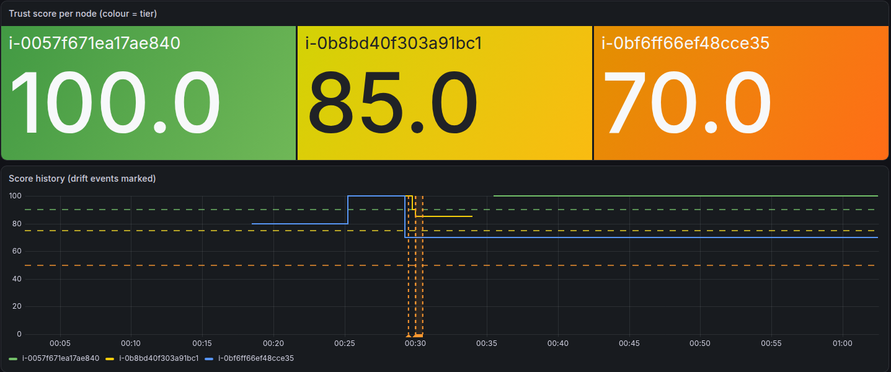
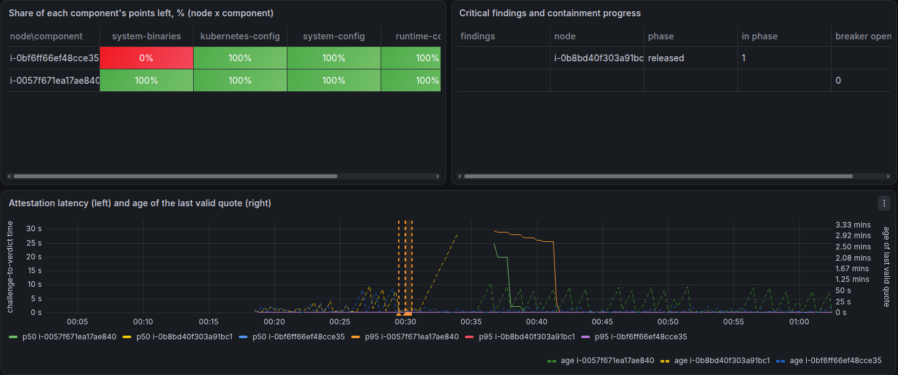

# Phase 6: observability

Metrics from the verifier and the trust controller, scraped by Prometheus
on the verifier host, five alert rules, and one Grafana dashboard
(blueprint Section 9). Code: `pkg/metrics` (a small Prometheus text-format
exporter, standard library only), `pkg/verifier/metrics.go`,
`pkg/controller/metrics.go`.

## Metrics

| Metric | Labels | From | Meaning |
| --- | --- | --- | --- |
| `node_trust_score` | node | verifier | current score, 0-100 |
| `node_trust_tier` | node, tier | verifier | 1 for the node's current tier |
| `node_trust_component_score` | node, component | verifier | points left in each component |
| `node_trust_mismatched_files` | node, component | verifier | sticky mismatch count this boot |
| `node_trust_critical_findings_total` | node, type | verifier | critical findings by type |
| `node_trust_drift_events_total` | node, class | verifier | sudden, isolated, gradual or unclassified drops |
| `node_attestation_age_seconds` | node | verifier | time since the last valid quote |
| `node_attestation_failures_total` | node, reason | verifier | unreachable, bad-evidence, outage |
| `node_attestation_duration_seconds` | node | verifier | histogram of challenge-to-verdict time |
| `node_containment_phase` | node, phase | controller | 1 for the current containment step |
| `node_containment_step_seconds` | step | controller | histogram of time from finding to each step done |
| `trust_circuit_breaker_open` | | controller | 1 while automatic containment is on hold |

Extra gauges used by the rules and the dashboard: `node_trust_critical`, `node_trust_unattested`, `node_trust_component_weight`,
`node_attestation_interval_seconds` (verifier), `trust_verifier_outage`,
`trust_controller_dry_run` (controller).

The verifier serves them on 127.0.0.1:9101 (`metrics_listen` in its
config), the controller on port 9102 of the control plane, which only the
verifier's security group may reach.

## Alerts (prometheus/rules.yml)

| Alert | Fires when |
| --- | --- |
| NodeTrustCritical | a node has a critical finding |
| NodeTrustDegraded | a node is in the degraded tier |
| NodeTrustGradualDrift | a gradual-drift event in the last 30 minutes |
| TrustCircuitBreakerOpen | the controller is holding containment for an operator |
| NodeAttestationStale | no valid quote for more than 3 of the node's challenge intervals |

They fire in Prometheus. Sending them on (Alertmanager to email or chat)
is left out: there is nowhere to send them from this test account.

## Dashboard (grafana/dashboards/nodetrust.json)

Five panels: the score per node coloured by tier, the score history with
drift and critical events marked, a node x component table of the points
left, critical findings with each node's containment phase and the
breaker, and attestation latency (p50, p95) with the age of the last
quote.

Prometheus and Grafana listen on 127.0.0.1 of the verifier host. To see the
dashboard from the laptop (needs the Session Manager plugin for the AWS
CLI):

```
aws ssm start-session --target "$(terraform -chdir=infra/cluster output -raw verifier_id)" \
  --document-name AWS-StartPortForwardingSession --parameters portNumber=3000,localPortNumber=3000
```

then open http://localhost:3000 (anonymous users can view; the admin
password is in /etc/nodetrust/grafana-admin-password on the verifier host).

## Run

The cluster from scratch with everything (the security group rule for
port 9102 is new):

```
cd infra/cluster && terraform apply && ./check-cluster.sh
cd ../phase3 && ./attest-cluster.sh
cd ../phase4 && ./check-boot.sh && ./join-reference.sh
ALLOWED_AMIS=ami-034d8e94160b0fecb ./deploy-verifier.sh
cd ../phase5 && DRY_RUN=0 ./deploy-controller.sh
cd ../phase6 && ./deploy-monitoring.sh
./check-monitoring.sh                       # the gate, about 20 minutes
```

deploy-monitoring.sh installs Prometheus (pinned LTS version, checked
against the release's sha256sums.txt) and Grafana (from Grafana's signed
apt repository) on the verifier host, and checks that both scrape targets
are up, the five rules are loaded and the dashboard exists.

check-monitoring.sh: three unknown binaries on worker 2 make it degraded
(70); three config edits on worker 1 make a gradual drift; a fake kubelet
makes worker 1 critical and the controller holds it at the circuit
breaker; after approval worker 1 is contained and its last quote ages.
Each of the five alerts must fire, and each of the twelve metrics must
have data. At the end worker 1 is terminated (snapshot kept) so the group
can launch its replacement under the 8-vCPU limit.

## Live run notes

Deploy (2026-11-26, a fresh cluster on ami-034d8e94160b0fecb): Prometheus
3.13.5 and Grafana 13.3.2 installed, promtool accepted the config and the
5 rules, both scrape targets up, the dashboard provisioned.

The fresh workers came up at warning 80, not healthy: both had read
/var/lib/logrotate/status and status.tmp. logrotate.timer is persistent,
so on a worker booted more than a day after the AMI was built it runs
right at boot; in all the earlier runs the AMI was less than a day old.
logrotate's state file is now in the runtime policy (exact paths only; any
other file in that directory still counts), and the redeployed verifier
clears the two files on its next cycle.

### Result: Phase 6 gate (2026-11-26 00:27 IST)

After the verifier redeploy both workers cleared the logrotate files and
went back to healthy after 3 cycles. check-monitoring.sh: fails=0.

- both scrape targets up; score, tier, component, mismatch, age, duration,
  breaker and drift metrics had data for the healthy nodes
- three unknown binaries on worker 2: degraded 70, NodeTrustDegraded fired
- config edits on worker 1: 95, 90, 85 and NodeTrustGradualDrift fired.
  The second edit was already gradual: the earlier logrotate drop (sudden,
  20) was still inside the 30-minute window, so the edits made the third
  drop sooner. The classification follows the rule as written.
- fake kubelet on worker 1: NodeTrustCritical and TrustCircuitBreakerOpen
  fired, containment phase "held"; after approval the phase went to
  "released" and NodeAttestationStale fired once worker 1 was cut off;
  unreachable failures were counted
- all twelve Section 9 metrics had data, and all five alerts fired during
  the run
- containment step times (mean, from the finding): cordoned 0.01 s;
  isolated 56 s, snapshotted 56.6 s, replaced 57.0 s, released 57.1 s (the
  56 s are the wait for the operator's approval at the circuit breaker;
  the AWS steps themselves took about a second)
- attestation duration p95: 0.24 s
- worker 1 terminated through the controller, snapshot kept

Dashboard, first look (screenshots after the gate run): the score panel
and the score history with drift and critical markers worked as meant. Two
panels were fixed: the component table coloured full components orange
(its percentage thresholds were relative to the values shown, and the node
names were coloured too), so it now shows each component's points left as
a percentage of that component's weight (`node_trust_component_weight`),
green at 100; and in the latency panel the age of the last quote
(minutes) hid the challenge time (under a second), so the age now has its
own axis on the right.

### Dashboard after the gate run



The replacement worker at 100 (green), worker 1 at 85 after its three
config edits (yellow, warning) and worker 2 at 70 after three unknown
binaries (orange, degraded). The history shows the logrotate drop and
recovery of worker 2 before the test, then the test itself around 00:30,
with the drift and critical events marked; worker 1's line ends when it
was contained and terminated.



Worker 2 has no system-binaries points left (three unknown binaries,
tolerance 3) and everything else full; worker 1 is "released" in the
containment table. In the latency panel the healthy replacement's age
(dashed green) is a saw-tooth that goes up to about 60 s and drops at
each challenge, which is the 60 s interval of a healthy node; worker 1's
age (dashed yellow) keeps rising after it was cut off, which is what
fired NodeAttestationStale. The challenge time is mostly under a second,
with spikes of 5-10 s on the cycles that carry the full forced-read sweep
(every 10th) and a p95 near 30 s for the replacement's first cycles (the
whole IMA log and the first full sweep), which leaves the 5-minute window
after about 5 minutes.
